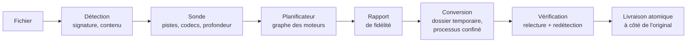

<div align="center">


# Chud Converter

**Le convertisseur de fichiers universel, local et honnête.**

Il reconnaît le vrai format de vos fichiers, choisit le meilleur chemin de conversion,
vous dit **avant** ce qui sera perdu, puis **vérifie** chaque résultat.
Vos originaux ne sont jamais touchés.

[](https://github.com/BigFatDeuce/chud-converter/actions/workflows/ci.yml)
[](LICENSE)


[Principes](#principes) ·
[Exemple](#un-exemple) ·
[Ce qui fonctionne](#ce-qui-fonctionne-déjà) ·
[Installation](#installation) ·
[Utilisation](#utilisation) ·
[Feuille de route](#feuille-de-route) ·
[Documentation](#documentation)

<sub><i>A universal, local and honest file converter. Documentation is in French for now.</i></sub>

</div>

> [!NOTE]
> **Version 0.1 — alpha.** Le moteur de conversion et la ligne de commande `chud` fonctionnent
> et sont testés sur de vrais fichiers. L'interface graphique (Tauri 2 + Svelte 5) est la
> prochaine étape, suivie du menu clic droit de l'Explorateur. Voir la [feuille de route](#feuille-de-route).

## Principes

| | |
|---|---|
| **Honnête** | Chaque conversion annonce sa fidélité — *sans perte*, *selon le contenu* ou *avec perte* — et liste ce qui disparaît : pistes, sous-titres, chapitres, transparence, profondeur de bits, métadonnées. Jamais de faux « sans perte », jamais une simple extension renommée. |
| **Vérifié** | Le résultat est relu par le moteur (décodage intégral quand c'est raisonnable) et son format est redétecté indépendamment. Un programme qui se termine « sans erreur » ne suffit pas. |
| **Prudent** | L'original n'est jamais modifié. Le travail se fait à l'écart ; le fichier final n'apparaît qu'une fois complet et vérifié. Un nom déjà pris donne `fichier (1).ext`. |
| **Local** | Tout se passe sur votre machine. Aucun fichier, aucun nom de fichier n'est envoyé sur Internet. Aucune télémétrie. |
| **Sûr** | Jamais de ligne de commande construite avec vos noms de fichiers. Archives piégées refusées. Moteurs externes confinés, limités dans le temps, arrêtés proprement à l'annulation. |
| **Transparent** | FFmpeg, 7-Zip et les autres moteurs sont détectés, jamais remplacés à votre insu ; leur version, leur origine et leur licence sont affichées. |

## Un exemple

Une vidéo MKV avec deux pistes audio et des sous-titres stylés, à passer en MP4 :

```console
$ chud plan vacances.mkv --to mp4
Plan : Matroska (MKV) (mkv) → MP4 (mp4)
  1. mkv → mp4 avec ffmpeg — selon le contenu
Fidélité : Selon le contenu du fichier
  • Étape 1 : la fidélité dépend du contenu du fichier
  • Étape 1 : vidéo h264 copiée sans ré-encodage
  • Étape 1 : audio aac copié sans ré-encodage
  • Étape 1 : sous-titres ASS convertis en mov_text : texte et temps conservés, styles avancés (polices, couleurs, positions, effets) perdus s'il y en a
```

La vidéo et le son sont copiés tels quels, mais le MP4 ne sait pas stocker les styles ASS :
le logiciel ne prétend donc pas que c'est « sans perte ». Puis :

```console
$ chud convert vacances.mkv --to mp4
✔ vacances.mkv → D:\Vidéos\vacances.mp4
    Fidélité : Selon le contenu du fichier
    …
    ✓ vérifié : flux et durée contrôlés par ffprobe ; décodage intégral sans erreur
```

Et une image PNG déguisée en `.jpg` ne trompe pas la détection :

```console
$ chud detect faux.jpg
faux.jpg : PNG (png) — confiance élevée, méthode : signature binaire
  ⚠ l'extension ne correspond pas au contenu
```

## Ce qui fonctionne déjà

| Domaine | Moteur | Ce qu'il sait faire |
|---|---|---|
| **Vidéo** | FFmpeg | MKV ⇄ MP4 sans ré-encodage, WebM, AVI, MOV, TS… ; choix du codec et de la qualité, redimensionnement, découpe ; conservation des pistes, chapitres et pochettes |
| **Audio** | FFmpeg | WAV → FLAC → ALAC identiques à l'octet près ; MP3, AAC, Opus, OGG… ; extraction de la piste d'une vidéo ; profondeur de bits et fréquence annoncées honnêtement |
| **Sous-titres** | FFmpeg | SRT, VTT, ASS, TTML ; extraction depuis une vidéo ; encodage des vieux fichiers (Windows-1252…) détecté |
| **Animations** | FFmpeg | vidéo → GIF (palette optimisée), WebP et APNG animés ; image extraite d'une vidéo |
| **Images** | natif (Rust) | PNG, JPEG, WebP, GIF, BMP, TIFF, ICO, TGA, QOI, PNM, HDR, EXR, DDS ; orientation EXIF, limites contre les images piégées |
| **Archives** | 7-Zip | ZIP, 7z, TAR, TGZ/TXZ/TZST, RAR (lecture), ISO, CAB, CBZ/CBR… ; dossier → archive, archive → dossier, archive → archive |
| **Données** | natif (Rust) | JSON ⇄ YAML ⇄ TOML ⇄ CSV ⇄ TSV ⇄ NDJSON |

Les tests automatiques, sur des fichiers réels générés à chaque exécution, couvrent notamment :
MKV → MP4 sans perte (vérifié par décodage), WebM, MP3, GIF, image extraite d'une vidéo,
sous-titres SRT en Windows-1252 → VTT, découpe, WAV → FLAC → ALAC identiques à l'octet,
allers-retours ZIP / 7z / TGZ, archives piégées, conflits de noms, annulation et fichiers
tronqués. Le reste du tableau est pris en charge mais pas encore couvert par un test dédié.

`chud formats` liste les **195 formats** reconnus ; avec FFmpeg et 7-Zip installés,
`chud matrix` en montre **1 706 conversions directes**, et le planificateur les enchaîne quand
il le faut.

Les extractions d'archives refusent les chemins qui sortent du dossier (`../`, chemins absolus),
les liens, les doublons de casse et les bombes de décompression.

## Comment ça marche



Chaque moteur déclare ce qu'il sait faire et avec quelle fidélité ; le planificateur choisit le
chemin qui perd le moins, puis le moins d'étapes, puis le plus rapide. Détails dans
[ARCHITECTURE](docs/ARCHITECTURE.md).

## Installation

> [!IMPORTANT]
> Pas encore de version prête à télécharger : les installeurs Windows et Linux arriveront avec
> l'interface graphique. En attendant, la ligne de commande se compile en une commande.

```bash
git clone https://github.com/BigFatDeuce/chud-converter.git
cd chud-converter
cargo build --release -p chud-cli
```

Il faut [Rust](https://rustup.rs) 1.88 ou plus récent (et, sous Windows, les Build Tools de
Visual Studio). Le programme obtenu est `target/release/chud` (`chud.exe` sous Windows).
Tout est détaillé dans [BUILDING](docs/BUILDING.md).

### Moteurs externes (facultatifs)

Les images et les données fonctionnent sans rien installer. Pour le reste, installez les
moteurs avec le gestionnaire de paquets de votre système ; `chud engines` vous dit ce qui est
trouvé et ce qui manque.

| Moteur | Apporte | Windows | Debian, Ubuntu |
|---|---|---|---|
| FFmpeg | vidéo, audio, sous-titres, animations | `winget install Gyan.FFmpeg` | `sudo apt install ffmpeg` |
| 7-Zip | archives | `winget install 7zip.7zip` | `sudo apt install 7zip` |

MKVToolNix, Pandoc, LibreOffice, Calibre, ImageMagick, libvips, qpdf, Ghostscript, Tesseract,
ExifTool et MediaInfo sont déjà détectés ; leur prise en charge arrive au fil des versions.

## Utilisation

| Commande | Rôle |
|---|---|
| `chud engines` | moteurs trouvés, versions, commandes d'installation |
| `chud detect <fichiers>` | vrai format de chaque fichier, extension trompeuse signalée |
| `chud targets <fichier>` | formats possibles pour ce fichier, avec la fidélité attendue |
| `chud plan <fichier> --to <format>` | plan, rapport de fidélité et options, sans rien écrire |
| `chud convert <fichiers> --to <format>` | conversion, vérification et rapport |
| `chud formats [recherche]` | formats connus, par catégorie |
| `chud matrix` | conversions offertes par chaque moteur |

```bash
# Toutes les vidéos .mov d'un dossier en MP4 léger 720p, dans un autre dossier
chud convert *.mov --to mp4 -s video_quality=small -s max_height=720 -o D:/Sorties

# Un album en FLAC, 4 conversions à la fois, en gardant les dates
chud convert *.wav --to flac -j 4 --keep-date

# Un dossier en archive 7z, compression maximale
chud convert "Mes documents" --to 7z -s level=9

# Extraire une archive (dans un dossier à côté d'elle)
chud convert sauvegarde.zip --to directory
```

- `-s clé=valeur` règle une option ; `chud plan` affiche les options de chaque étape.
- `--on-conflict rename|skip|overwrite` : renommer (par défaut), ignorer ou remplacer — jamais la source.
- `--name "{stem}-web"` : modèle du nom de sortie.
- `--json` sur toutes les commandes, pour les scripts.
- Code de sortie : `0` tout a réussi, `1` au moins un échec, `2` erreur d'utilisation.

**Mode portable** : un fichier vide nommé `portable` à côté de `chud.exe`, et réglages, cache
et moteurs gérés restent dans un dossier `data` voisin — rien dans le profil utilisateur.

## Feuille de route

- [x] Recherche, architecture et modèle de sécurité
- [x] Cœur : détection, planification, rapport de fidélité, tâches vérifiées et annulables
- [x] Moteurs : images et données natifs, FFmpeg, 7-Zip
- [x] Ligne de commande `chud`
- [ ] Interface graphique Tauri 2 + Svelte 5 — **prochaine étape**
- [ ] Préréglages et menu clic droit (Explorateur Windows, Dolphin, Nautilus, Nemo, Thunar)
- [ ] Installation et mise à jour vérifiées des moteurs
- [ ] PDF, documents, livres électroniques (qpdf, LibreOffice, Pandoc, Calibre), OCR
- [ ] Inspecteur universel, détecteur de doublons, optimisation automatique
- [ ] Workflows visuels, surveillance de dossiers, historique, plugins
- [ ] Installeurs Windows et Linux, mises à jour signées

Le détail, case par case, est dans [ROADMAP](docs/ROADMAP.md) : une case n'y est cochée que
lorsque la fonction est réalisée **et** testée sur de vrais fichiers.

## Documentation

| Document | Contenu |
|---|---|
| [ARCHITECTURE](docs/ARCHITECTURE.md) | modules, déroulé d'une conversion, modèle de fidélité |
| [DECISIONS](docs/DECISIONS.md) | décisions techniques (ADR) et leurs raisons |
| [SECURITY](docs/SECURITY.md) | menaces, parades, état de chaque mesure |
| [ENGINE-MANAGER](docs/ENGINE-MANAGER.md) | détection, installation et mise à jour des moteurs |
| [SHELL-INTEGRATION](docs/SHELL-INTEGRATION.md) | menu clic droit sous Windows et Linux |
| [PLUGINS](docs/PLUGINS.md) · [WORKFLOWS](docs/WORKFLOWS.md) | extensions et chaînes de traitement |
| [RESEARCH](docs/RESEARCH.md) | étude des technologies, des moteurs et des logiciels existants |
| [LICENSES](docs/LICENSES.md) | licences des moteurs et des dépendances |
| [BUILDING](docs/BUILDING.md) | compiler, tester, contribuer |

## Contribuer

Les rapports de bogue et les propositions sont les bienvenus dans les
[issues](https://github.com/BigFatDeuce/chud-converter/issues). Avant une contribution de code :
`cargo fmt`, `cargo clippy --workspace` et `cargo test --workspace`, et les règles de
[BUILDING](docs/BUILDING.md#6-règles-de-contribution).

Une faille de sécurité se signale **en privé**, via
[GitHub Security Advisories](https://github.com/BigFatDeuce/chud-converter/security/advisories/new),
jamais dans une issue publique.

## Licence

Chud Converter est un logiciel libre, distribué sous licence
[GNU GPL version 3 ou ultérieure](LICENSE).

Les moteurs externes (FFmpeg, 7-Zip…) ne sont pas fournis avec le logiciel : ils sont installés
par vous et gardent leur propre licence, détaillée dans [LICENSES](docs/LICENSES.md).

<div align="center">
<sub>Construit avec Rust, et grâce à FFmpeg, 7-Zip, et aux crates <code>image</code>, <code>clap</code>, <code>serde</code> et bien d'autres.</sub>
</div>
