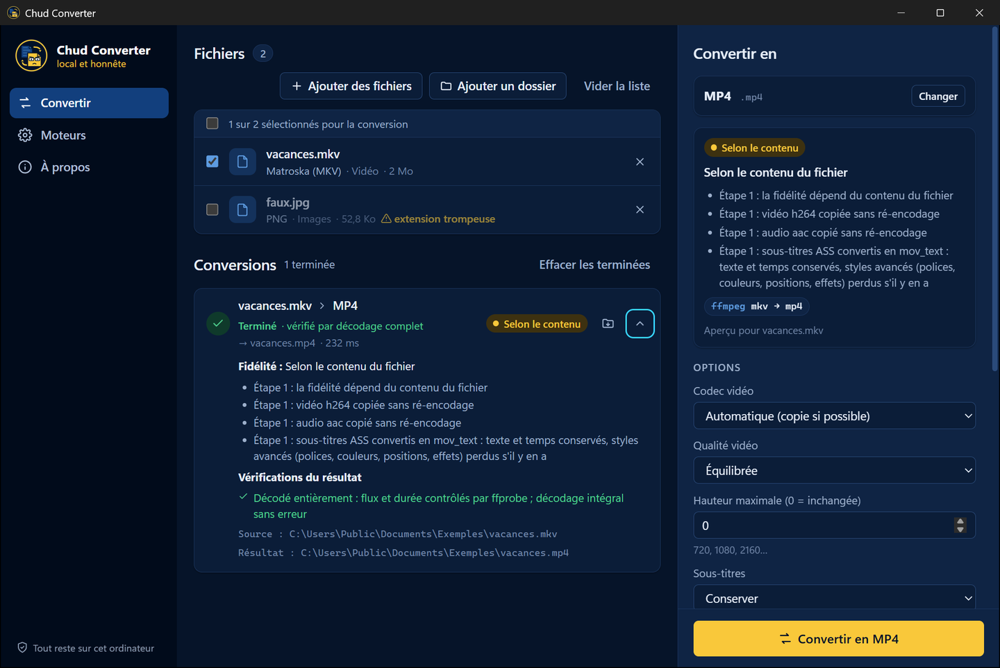
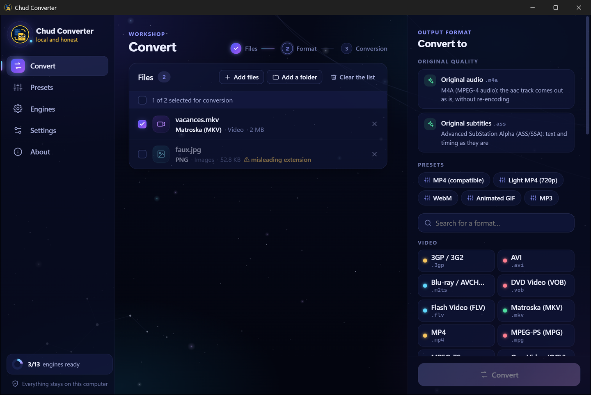
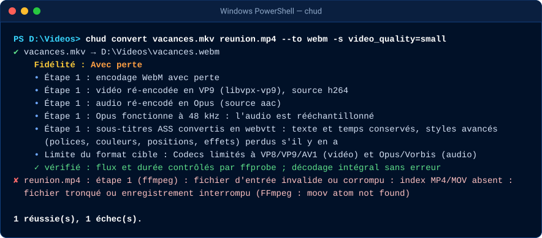
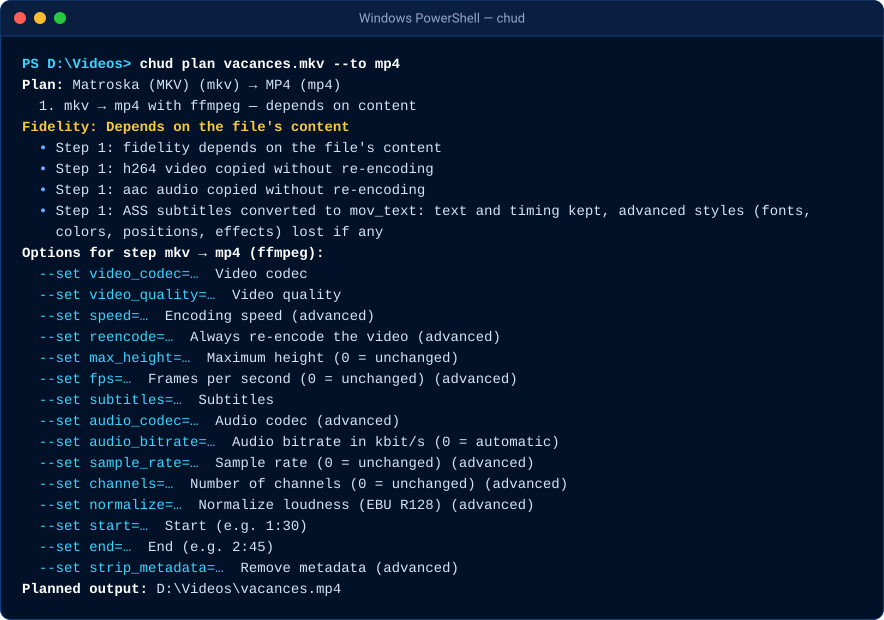
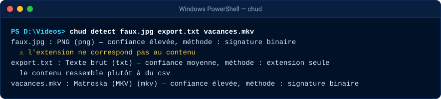
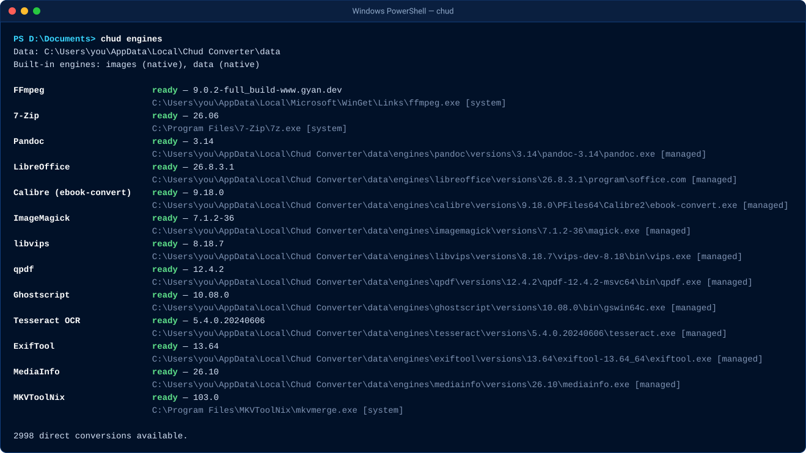
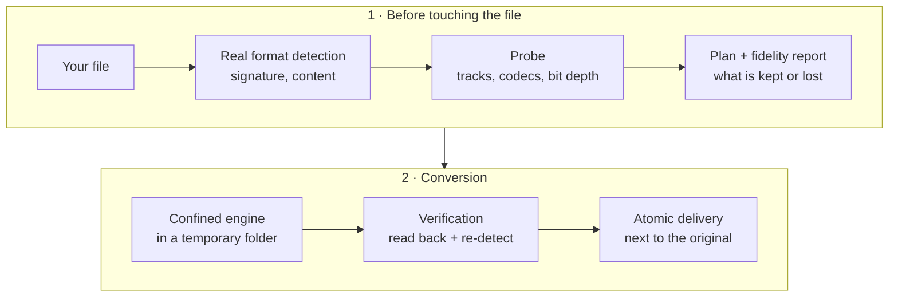

<div align="center">


# Chud Converter

**The universal, local and honest file converter.**

It finds out what your files really are, picks the best conversion path,
tells you **beforehand** what will be lost, then **verifies** every result.
Your originals are never touched.

[](https://github.com/BigFatDeuce/chud-converter/actions/workflows/ci.yml)
[](LICENSE)


[Principles](#principles) ·
[Screenshots](#screenshots) ·
[Features](#what-works-today) ·
[Install](#installation) ·
[Usage](#usage) ·
[Roadmap](#roadmap) ·
[Docs](#documentation)

</div>

<p align="center">
  
  <br>
  <sub><i>The real desktop app. The losses are announced before converting (styled subtitles in MP4), the original is untouched, and the result is fully decoded to verify it.</i></sub>
</p>

> [!NOTE]
> **Version 0.1 — alpha.** [Download](https://github.com/BigFatDeuce/chud-converter/releases/latest). The conversion engine, the desktop app (Tauri 2 + Svelte 5) and the
> `chud` command line work and are tested on real files. The app is tested on Windows and built
> on Linux by the CI. Presets and the File Explorer right-click menu work on Windows. The whole program
> speaks **English and French**.

## Principles

| | |
|---|---|
| **Honest** | Every conversion states its fidelity — *lossless*, *depends on content* or *lossy* — and lists what goes away: tracks, subtitles, chapters, transparency, bit depth, metadata. Never a fake "lossless", never just a renamed extension. |
| **Verified** | The result is read back by the engine (fully decoded when reasonable) and its format is detected again, independently. A tool that "exited without error" is not proof of success. |
| **Careful** | The original is never modified. Work happens in a separate folder; the final file only appears once complete and verified. A name already taken becomes `file (1).ext`. |
| **Local** | Everything happens on your machine. No file, no file name is ever sent over the Internet. No telemetry. |
| **Safe** | Command lines are never built from your file names. Booby-trapped archives are refused. External engines are confined, time-limited and cleanly stopped on cancel. |
| **Transparent** | FFmpeg, 7-Zip and the other engines are detected, never silently replaced; their version, origin and license are shown. |
| **Bilingual** | English and French everywhere: app, fidelity reports, errors, command line, right-click menu. It follows the system language until you pick one. |

## Screenshots

All screenshots are real output of the current version, made with real files. Only local paths
in the terminal screenshots were replaced with neutral ones.

### Desktop app

**Pick a format.** Files are identified by their content (here `faux.jpg` is flagged: it is
really a PNG). Every possible output format carries a colored dot for its fidelity: green
lossless, blue content intact, yellow depends on content, red lossy. With several files
selected, only the formats they all support are offered, with the worst fidelity among them.

<p align="center"></p>

The app also offers options generated from each engine (codec, quality, size, subtitles…),
the destination (next to the original or another folder), what to do when the file already
exists, a queue you can add to while it runs, per-file cancellation, and an **Engines** page
showing what is installed.

### Command line

The same engine, for scripts and terminals:

<p align="center"></p>

**Plan before converting.** `chud plan` shows the path, the expected fidelity and every option,
without writing anything. Here, video and audio are copied untouched, but MP4 cannot store
styled ASS subtitles, so the conversion is *not* called lossless:

<p align="center"></p>

**Real format detection.** File signatures and content, not extensions:

<p align="center"></p>

**Engines found on your machine**, with their version, location and the official command to
install the missing ones:

<p align="center"></p>

## What works today

| Domain | Engine | What it can do |
|---|---|---|
| **Video** | FFmpeg | MKV ⇄ MP4 without re-encoding, WebM, AVI, MOV, TS…; codec and quality choice, resizing, trimming; keeps tracks, chapters and cover art |
| **Audio** | FFmpeg | WAV → FLAC → ALAC bit-identical; MP3, AAC, Opus, OGG…; audio extraction from video; bit depth and sample rate reported honestly |
| **Subtitles** | FFmpeg | SRT, VTT, ASS, TTML; extraction from video; legacy encodings (Windows-1252…) detected |
| **Animations** | FFmpeg | video → GIF (optimized palette), animated WebP and APNG; still frame from a video |
| **Images** | native (Rust) | PNG, JPEG, WebP, GIF, BMP, TIFF, ICO, TGA, QOI, PNM, HDR, EXR, DDS; EXIF orientation, limits against malicious images |
| **Archives** | 7-Zip | ZIP, 7z, TAR, TGZ/TXZ/TZST, RAR (read), ISO, CAB, CBZ/CBR…; folder → archive, archive → folder, archive → archive |
| **Data** | native (Rust) | JSON ⇄ YAML ⇄ TOML ⇄ CSV ⇄ TSV ⇄ NDJSON |

The automated tests run on real files generated at each run, on Windows and Linux. They cover
MKV → MP4 lossless (checked by decoding), WebM, MP3, GIF, frame extraction, Windows-1252 SRT →
VTT, trimming, WAV → FLAC → ALAC bit-identical, ZIP / 7z / TGZ round trips, malicious archives,
name conflicts, cancellation and truncated files. The rest of the table is supported but not
yet covered by a dedicated test.

`chud formats` lists the **195 known formats**. With FFmpeg and 7-Zip installed, `chud matrix`
shows **1,706 direct conversions**, and the planner chains them when needed.

Archive extraction refuses paths that escape the target folder (`../`, absolute paths), links,
case-only duplicates and decompression bombs.

## How it works



Each engine declares what it can do and with what fidelity. The planner picks the path that
loses the least, then the one with the fewest steps, then the fastest. Details in
[ARCHITECTURE](docs/ARCHITECTURE.md) (French).

## Installation

Download the latest version from the [**Releases page**](https://github.com/BigFatDeuce/chud-converter/releases/latest):

| System | File | Notes |
|---|---|---|
| Windows 10/11 | `Chud.Converter_…_x64-setup.exe` | installs for your account only, no administrator rights; updates itself |
| Windows, portable | `Chud.Converter_…_x64_portable.zip` | unzip anywhere; settings stay in a `data` folder next to it |
| Linux | `.AppImage` | runs anywhere; updates itself |
| Debian, Ubuntu / Fedora, openSUSE | `.deb` / `.rpm` | the app tells you when a new version is out |
| Command line only | `chud_…_windows_x64.zip`, `chud_…_linux_x86_64.tar.gz` | the `chud` program alone |

The installers are not code-signed yet, so Windows SmartScreen may warn the first time
(*More info* → *Run anyway*). Every file is listed with its SHA-256 in `SHA256SUMS.txt`.
Uninstalling (Windows *Settings* → *Apps*) also removes the right-click menu.

**Updates.** The app checks for a new version at startup, at most once a day (it can be turned
off in *Settings*), and installs it only when you click *Install and restart*. Only the
description of the latest release is read from GitHub; none of your files or file names are
sent. Every update is signed with the project's key and checked before it is installed: a file
whose signature does not match is refused. To go back, install an earlier version from the
Releases page.

### Build from source

```bash
git clone https://github.com/BigFatDeuce/chud-converter.git
cd chud-converter

# Command line
cargo build --release -p chud-cli

# Desktop app: build the interface first, the program embeds it
npm --prefix apps/desktop ci
npm --prefix apps/desktop run build
cargo build --release -p chud-desktop
```

You need [Rust](https://rustup.rs) 1.88 or newer (on Windows, with the Visual Studio Build
Tools) and, for the desktop app, [Node.js](https://nodejs.org) 20 or newer. On Linux the
desktop app also needs WebKitGTK (`libwebkit2gtk-4.1-dev` and friends, listed in
[BUILDING](docs/BUILDING.md)).

The programs are `target/release/chud` and `target/release/chud-converter` (`.exe` on Windows).
`chud-converter file1 file2…` opens the app with those files already in the list. See
[BUILDING](docs/BUILDING.md) (French) for details.

### External engines (optional)

Images and data work with nothing else installed. For the rest, install the engines with your
system's package manager; `chud engines` tells you what is found and what is missing.

| Engine | Adds | Windows | Debian, Ubuntu |
|---|---|---|---|
| FFmpeg | video, audio, subtitles, animations | `winget install Gyan.FFmpeg` | `sudo apt install ffmpeg` |
| 7-Zip | archives | `winget install 7zip.7zip` | `sudo apt install 7zip` |

MKVToolNix, Pandoc, LibreOffice, Calibre, ImageMagick, libvips, qpdf, Ghostscript, Tesseract,
ExifTool and MediaInfo are already detected; support for them is coming release by release.

## Usage

**Desktop app:** drop files or folders on the window (or open it with files as arguments),
pick an output format, check the plan and the options, then convert. Results appear next to
the originals unless you choose another folder.

**Presets and right-click menu:** a preset is a format, options and a destination saved under a
name (21 are provided: MP4, light 720p MP4, WebM, MP3, FLAC, JPEG, WebP, ZIP, extract here…).
Apply one in the Convert screen, manage them in the *Presets* screen, and turn on the
**right-click menu** there (or with `chud shell install`): right-click files in File Explorer →
*Chud Converter* → a preset. A small window follows the conversions and closes by itself when
everything succeeded. The menu is installed for your account only, without administrator
rights, and `chud shell uninstall` removes exactly what was added. On Windows 11 it is under
*Show more options* (Shift+F10).

**Language:** English or French, in the app's *Settings* screen, with `chud language en|fr|system`,
or for one command with `--lang en`. The choice is shared by the app, the command line and the
right-click menu (an installed menu is rewritten in the new language). By default the system
language is used: French on a French system, English otherwise.

**Command line:**

| Command | Purpose |
|---|---|
| `chud engines` | engines found, versions, install commands |
| `chud detect <files>` | real format of each file, misleading extensions flagged |
| `chud targets <file>` | possible output formats for this file, with expected fidelity |
| `chud plan <file> --to <format>` | plan, fidelity report and options, without writing anything |
| `chud convert <files> --to <format>` | conversion, verification and report |
| `chud convert <files> --preset <id>` | conversion with a preset (`chud presets` lists them) |
| `chud shell install` · `uninstall` · `status` | right-click menu of the file manager |
| `chud language [en\|fr\|system]` | shows or changes the language |
| `chud formats [search]` | known formats, by category |
| `chud matrix` | conversions offered by each engine |

```bash
# Every .mov in a folder to a light 720p MP4, into another folder
chud convert *.mov --to mp4 -s video_quality=small -s max_height=720 -o D:/Output

# An album to FLAC, 4 conversions at a time, keeping the file dates
chud convert *.wav --to flac -j 4 --keep-date

# A folder into a 7z archive, maximum compression
chud convert "My documents" --to 7z -s level=9

# Extract an archive (into a folder next to it)
chud convert backup.zip --to directory
```

- `-s key=value` sets an option; `chud plan` lists the options of each step.
- `--on-conflict rename|skip|overwrite`: rename (default), skip or replace — never the source.
- `--name "{stem}-web"`: output name template.
- `--json` on every command, for scripts; `--lang en|fr` for the messages of one command.
- Exit code: `0` all succeeded, `1` at least one failure, `2` usage error.

**Portable mode**: put an empty file named `portable` next to `chud.exe`; settings, cache and
managed engines then stay in a `data` folder beside it — nothing in your user profile.

## Roadmap

- [x] Research, architecture and security model
- [x] Core: detection, planning, fidelity report, verified and cancellable jobs
- [x] Engines: native images and data, FFmpeg, 7-Zip
- [x] `chud` command line
- [x] Continuous integration on Windows and Linux with real engines
- [x] Desktop app, Tauri 2 + Svelte 5 — first version
- [x] Presets, quick-convert window, right-click menu in Windows File Explorer
- [ ] Right-click menu on Linux: Dolphin, Nemo, Nautilus written but not yet tried on a real desktop; Thunar to do
- [x] English and French, switchable in the settings
- [ ] Verified installation and updates of engines
- [ ] PDF, documents, e-books (qpdf, LibreOffice, Pandoc, Calibre), OCR
- [ ] Universal inspector, duplicate finder, automatic optimization
- [ ] Visual workflows, watch folders, history, plugins
- [x] Windows and Linux installers, signed in-app updates

The detailed checklist is in [ROADMAP](docs/ROADMAP.md) (French): an item is only checked
once it is built **and** tested on real files.

## Documentation

The design documents are written in French for now.

| Document | Content |
|---|---|
| [ARCHITECTURE](docs/ARCHITECTURE.md) | modules, life of a conversion, fidelity model |
| [DECISIONS](docs/DECISIONS.md) | technical decisions (ADRs) and their reasons |
| [SECURITY](docs/SECURITY.md) | threats, mitigations, status of each measure |
| [ENGINE-MANAGER](docs/ENGINE-MANAGER.md) | detection, installation and updates of engines |
| [SHELL-INTEGRATION](docs/SHELL-INTEGRATION.md) | right-click menu on Windows and Linux |
| [PLUGINS](docs/PLUGINS.md) · [WORKFLOWS](docs/WORKFLOWS.md) | extensions and processing chains |
| [RESEARCH](docs/RESEARCH.md) | study of technologies, engines and existing software |
| [LICENSES](docs/LICENSES.md) | licenses of engines and dependencies |
| [BUILDING](docs/BUILDING.md) | build, test, contribute |

## Contributing

Bug reports and ideas are welcome in the
[issues](https://github.com/BigFatDeuce/chud-converter/issues), in English or French. Before
contributing code, run `cargo fmt`, `cargo clippy --workspace` and `cargo test --workspace`, and
follow the rules in [BUILDING](docs/BUILDING.md#6-règles-de-contribution).

Please report security vulnerabilities **privately** through
[GitHub Security Advisories](https://github.com/BigFatDeuce/chud-converter/security/advisories/new),
never in a public issue.

## License

Chud Converter is free software, released under the
[GNU General Public License, version 3 or later](LICENSE).

External engines (FFmpeg, 7-Zip…) are not shipped with it: you install them, and they keep
their own licenses, listed in [LICENSES](docs/LICENSES.md).

<div align="center">
<sub>Built with Rust, Tauri and Svelte, thanks to FFmpeg, 7-Zip, and the <code>image</code>, <code>clap</code>, <code>serde</code> crates and many more.</sub>
</div>
